<p align="center">
  
</p>
<p align="center"><a href="README.md">English</a> · <a href="README.zh-TW.md">繁體中文</a></p>

# research-master

**An AI research team in a box for Claude Code — one that will not let you cherry-pick your own results.**

Fourteen roles (a mentor, a math reviewer, an engineer, a blind peer reviewer, a
regression gate, …), a short constitution every role must acknowledge before it
works, and the files where your project's real state lives. MIT-licensed.

## Is this for you?

You are a graduate student, or anyone starting out in research, with Claude Code,
a git repository for your project (empty is fine) and ten minutes. You do not
need to know what a "skill" or a "subagent" is; each role explains itself when
you call it.

## Your first ten minutes

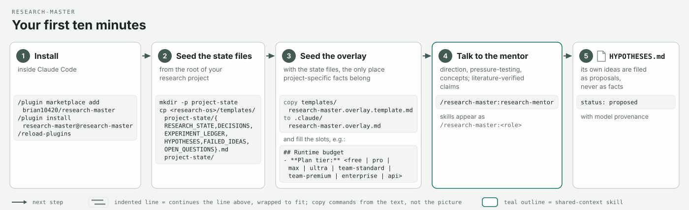

1. **Install**, inside Claude Code:
   ```
   /plugin marketplace add brian10420/research-master
   /plugin install research-master@research-master
   /reload-plugins
   ```
2. **Seed your project's state files** — six Markdown files where results,
   decisions, hypotheses and open questions get recorded. Copy them from
   [`templates/project-state/`](templates/project-state/); its README has the
   exact commands.
3. **Seed the overlay** — copy
   [`templates/research-master.overlay.template.md`](templates/research-master.overlay.template.md)
   to `.claude/research-master.overlay.md` in your project and fill the
   `## Project` block and the `Plan tier:` line (see "Pick your plan tier").
   With the state files, it holds *your* project's facts, and a plugin update
   never overwrites it.
4. **Talk to the mentor:** `/research-master:research-mentor`. Say what you are
   trying to find out. It discusses direction and pressure-tests the idea; what
   it proposes is filed in your `HYPOTHESES.md` as `status: proposed`, with its
   name on it — never as a fact.

Every role's first line is `ACK RULES_HASH=…`. That is the handshake proving it
loaded the rules; if the line is missing or its hash is not the current one,
the role did not load the current rules.

## Meet the team

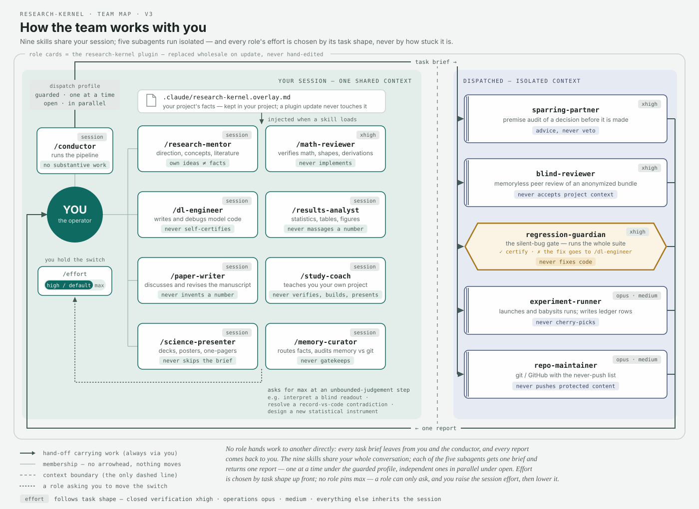


Ask by need, not by name. Nine roles work **inside** your conversation:

| | you want to… | call | it will never… |
| --- | --- | --- | --- |
|  | understand your own project; rehearse a defense | `/research-master:study-coach` | verify, build or present |
|  | discuss direction; test an idea against the literature | `/research-master:research-mentor` | assert its own ideas as facts |
|  | check a derivation, shapes, numerics | `/research-master:math-reviewer` | implement |
|  | write or debug model, training or data code | `/research-master:dl-engineer` | certify its own code |
|  | turn runs into statistics, tables, figures | `/research-master:results-analyst` | massage a number |
|  | draft and revise the manuscript; document mode: proposals, protocols, consent forms, reports | `/research-master:paper-writer` | invent a number; re-inflate a downgraded claim |
|  | make a talk, poster or one-pager | `/research-master:science-presenter` | compute a new statistic; skip the brief |
|  | run a multi-stage pipeline with checkpoints | `/research-master:conductor` | do the stages' work itself; skip a MANDATORY stop; override a HARD-STOP |
|  | keep the recall layer tidy | `/research-master:memory-curator` | gatekeep; edit `core/`; commit a scientific claim |

Five roles run **outside** it, as subagents with a fresh context, so they cannot
inherit your assumptions. Your session dispatches them — you or the conductor;
agents never dispatch:

| | dispatched role | what it does | it will never… |
| --- | --- | --- | --- |
|  | `blind-reviewer` | reviews your anonymized manuscript like a stranger | accept project context |
|  | `sparring-partner` | audits the premises of a decision before it is made; on request, your claim set before submission | veto; see the proposer's reasoning |
|  | `regression-guardian` | runs the whole test suite; certifies or rejects a change | fix code; certify from a partial run |
|  | `experiment-runner` | launches and babysits runs; writes the ledger rows | cherry-pick; deviate from protocol |
|  | `repo-maintainer` | git and GitHub, with a never-push list | push protected content; forced push unasked |

## The workflows

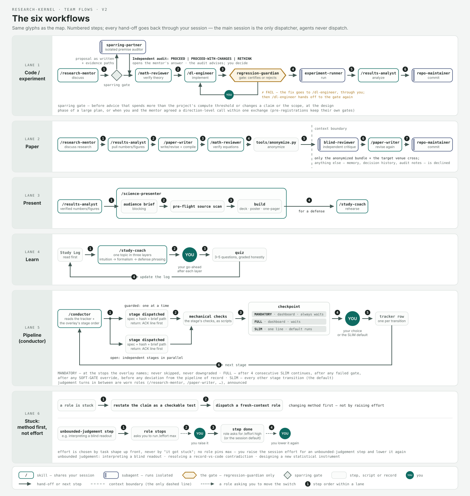

Build-and-test passes the guardian's gate; the paper loop hands the blind
reviewer only the anonymized bundle; learning cycles back into your Study Log;
presenting starts from verified numbers; the pipeline lane stops you only at
named checkpoints; and when you are stuck the team changes **method** first, not effort.

## Scenarios

Nine situations, each drawn with you as the capped logo bear and the roles
in the order you call them. Every label on a figure traces to a spec line or to
the operator's own words; the claims tables are in [`assets/README.md`](assets/README.md).

**1 · "Run my thesis end to end."** `/research-master:conductor` reads the
tracker, dispatches each stage with spec + hash + brief, and stops you at its
checkpoints (MANDATORY · FULL · SLIM); it does none of the stages' work.

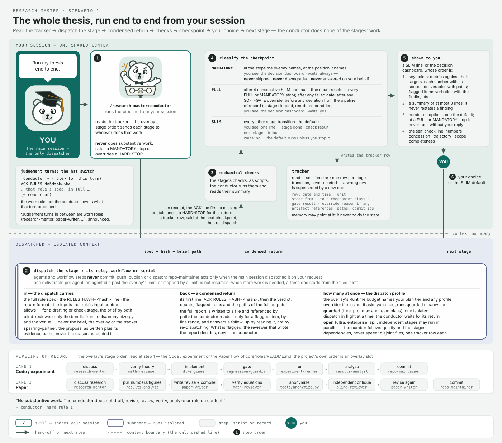

**2 · "My defense is in two weeks — drill me."** `/research-master:results-analyst`
→ `/research-master:science-presenter` → `/research-master:study-coach`; the
Study Log carries each round into the next.

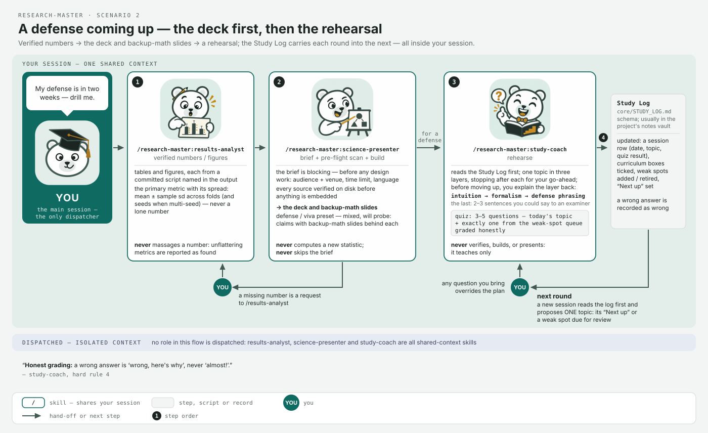

**3 · "Submit to &lt;venue&gt;."** `dispatch sparring-partner` (claim-set mode) →
`/research-master:paper-writer` → `tools/anonymize.py` → `dispatch blind-reviewer`
→ `/research-master:paper-writer` → `dispatch repo-maintainer`.

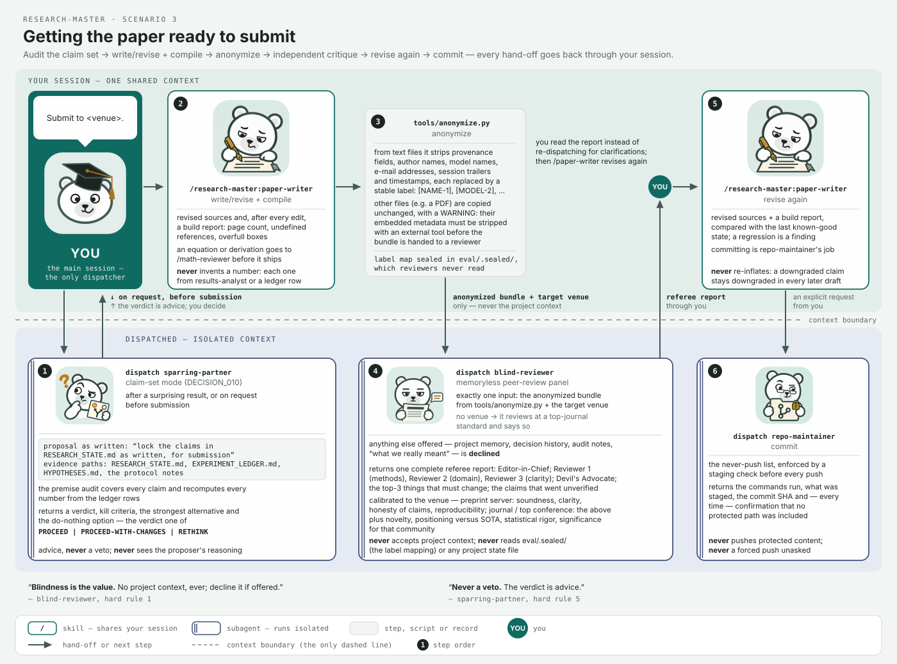

**4 · "My advisor wants results and slides tomorrow."**
`/research-master:results-analyst` → `/research-master:science-presenter`
(audience brief → pre-flight source scan → build); "tomorrow" does not waive the brief.

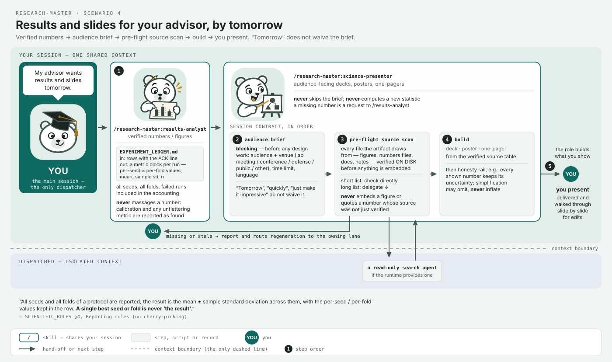

**5 · "New idea for the model — let's try it today."**
`/research-master:research-mentor` (sparring gate: `dispatch sparring-partner`)
→ `/research-master:math-reviewer` → `/research-master:dl-engineer` →
`dispatch regression-guardian`; a ✗ FAIL comes back through you to the engineer.

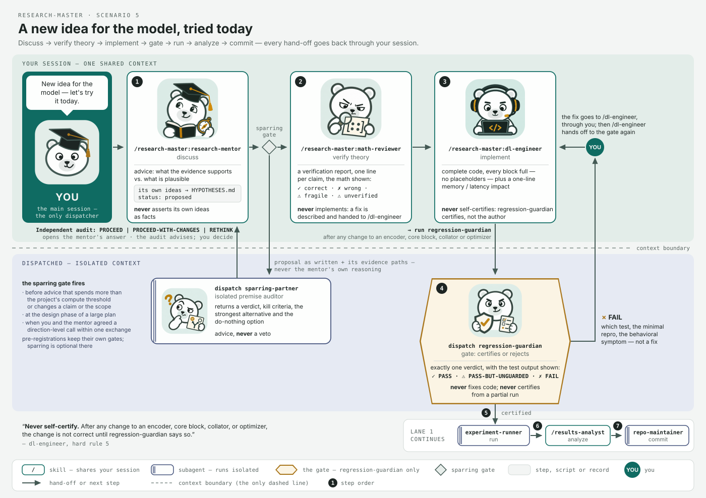

**6 · "Help me write the 研究計畫書 (grant / collaboration proposal)."**
`/research-master:research-mentor` → sparring gate (`dispatch sparring-partner`)
→ `/research-master:paper-writer` (document mode) → you read it in full →
`dispatch repo-maintainer`.

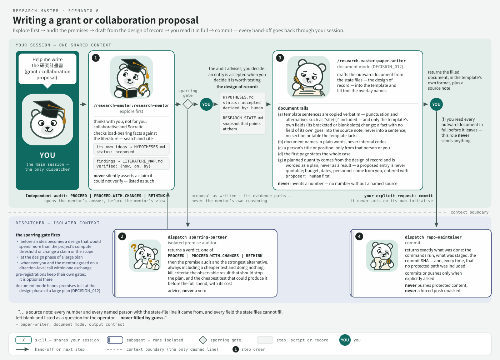

**7 · "The institution wants it in Word."** *Operator's setup.*
`/research-master:paper-writer` (document mode) → the docx skill fills the
institution's template → render and look → you read it in full.

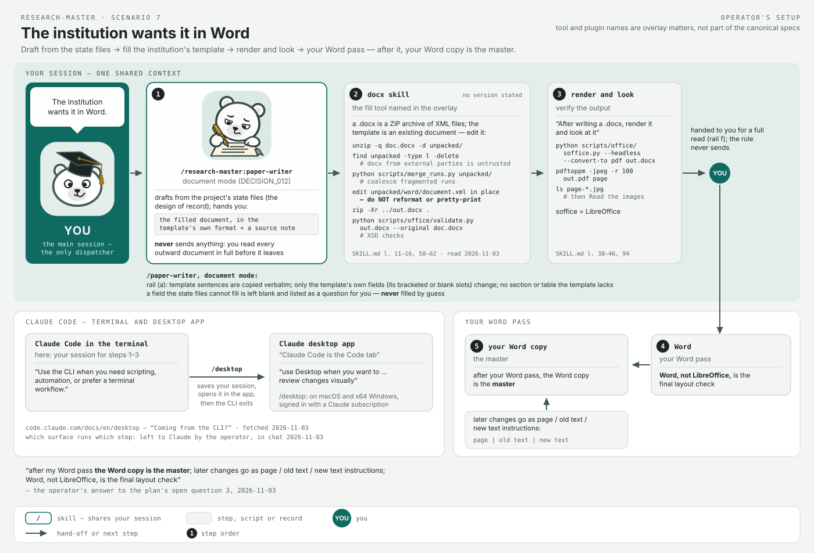

**8 · "Where do my other plugins fit?"** *Operator's setup.* superpowers before
any build; ARS `deep-research` feeds `/research-master:research-mentor`'s
literature verification, ARS `academic-paper` feeds `/research-master:paper-writer`;
ARS `academic-paper-reviewer` rehearses in your session, while
`dispatch blind-reviewer` stays the isolated review of record.

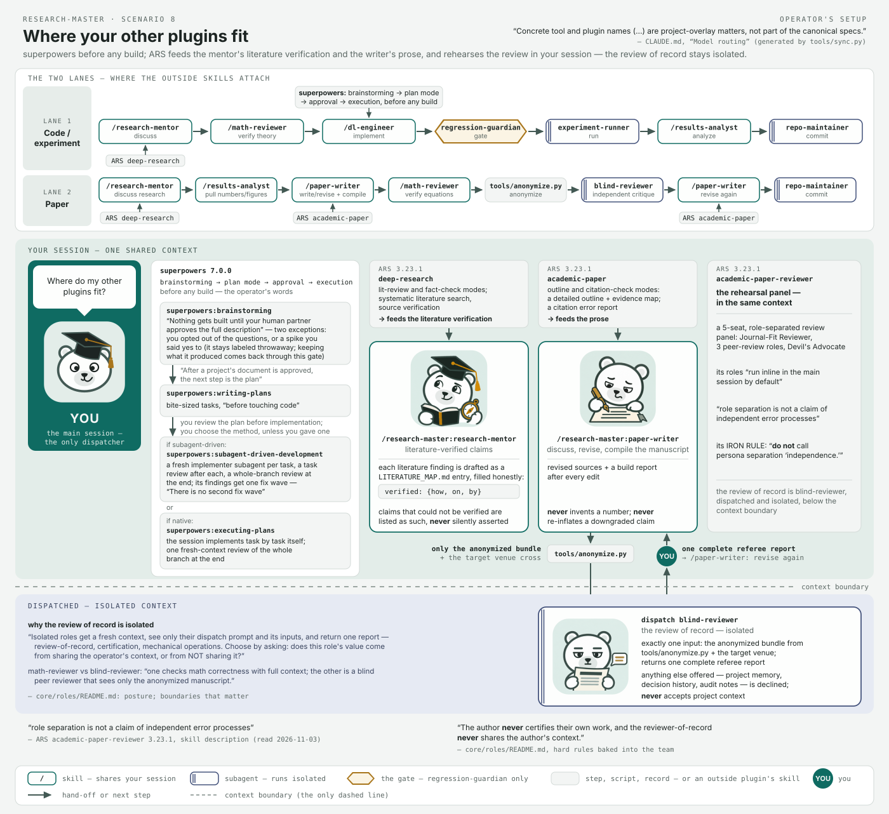

**9 · "We're crossing into a clinical study — write the IRB protocol and consent."**
a discipline card, when your overlay names one → `/research-master:conductor` →
`/research-master:research-mentor` → sparring gate (`dispatch sparring-partner`)
→ `/research-master:paper-writer` (document mode) → you read it in full.


## Why it will not let you cherry-pick

Every run gets a ledger row before its numbers exist, every idea carries the
name of whoever proposed it, and only you turn a proposal into a fact. The seven
rules behind that live in [`core/SCIENTIFIC_RULES.md`](core/SCIENTIFIC_RULES.md).

<details>
<summary><b>The seven rules, in plain words</b></summary>

1. Git, your notes and the experiment ledger are the only scientific source of truth; a model's memory is a reminder, never an authority.
2. Every hypothesis and decision names who proposed it, when, its status, and links to its evidence.
3. Ideas from a model enter as *proposals*; only you accept them.
4. The blind reviewer never learns who wrote what.
5. Every role proves it loaded the rules — the `ACK RULES_HASH` line.
6. Every run gets a ledger row before its numbers exist; all seeds, all folds, failed runs too; nothing is deleted.
7. Knowledge moves between layers as reviewed diffs, never as pasted transcripts.

</details>

## Pick your plan tier

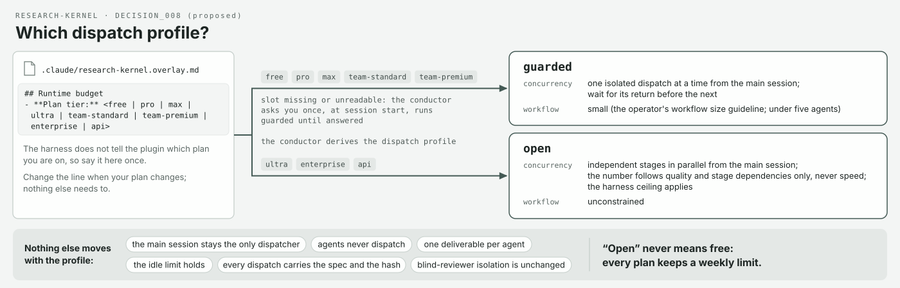

Claude Code cannot tell the plugin which plan you are on, so you say it once, in
your overlay:

```
## Runtime budget
- **Plan tier:** pro
```

| your plan | profile | what the conductor does |
| --- | --- | --- |
| free, pro, max, team-standard, team-premium | `guarded` | one isolated role in flight at a time; waits for its report; workflows stay small |
| ultra, enterprise, api | `open` | independent stages in parallel, as many as quality and dependencies warrant, never for speed, up to the harness ceiling |

Missing or unknown line → `guarded` until you answer the conductor's one
question at session start; an optional `Dispatch profile override:` line can set
either profile. **Open never means free:** every plan keeps a weekly
limit. What never changes with the profile: your session is the only thing that
dispatches, commits or publishes; agents never spawn agents; one deliverable per
agent; the idle limit holds; every dispatch carries the spec and the hash; the
blind reviewer stays blind. `claude plugin details research-master`
lists the 9 skills and 5 agents and their always-on token cost.

<details>
<summary><b>Where things live — two layers, two homes</b></summary>

| layer | lives in | contents |
| --- | --- | --- |
| **cross-project** | *this repository* | `core/SCIENTIFIC_RULES.md` (the constitution), `core/roles/` (canonical role specs), cross-project `core/DECISIONS.md`, the effort and dispatch policies, schemas for every state file, the compile layer, the evaluation scaffold |
| **per-project** | *each research project's own repository* | `RESEARCH_STATE.md`, `DECISIONS.md`, `EXPERIMENT_LEDGER.md`, `HYPOTHESES.md`, `FAILED_IDEAS.md`, `OPEN_QUESTIONS.md`, seeded from [`templates/project-state/`](templates/project-state/), plus the overlay |

Model memory (any vendor) is a recall layer, never an authority layer. Git, the
notes vault and the experiment ledgers are the only scientific source of truth
(`core/SCIENTIFIC_RULES.md` §0–§1). Formerly `claude_research_team`; renamed on
GitHub to `research-kernel` (renamed `research-master` in 0.6.0) — see [`MIGRATION_AUDIT.md`](MIGRATION_AUDIT.md).
Built on the provider-neutral **research-os** architecture; internal schemas
keep the `research-os/` namespace.

</details>

<details>
<summary><b>Layout of this repository</b></summary>

```
core/                     canonical, provider-neutral — edit HERE
  SCIENTIFIC_RULES.md     rules; RULES_HASH = sha256(this file)[:12]
  DECISIONS.md            DECISION_000 … DECISION_008 (architecture, memory, effort, roles, §9, dispatch profile)
  RESEARCH_STATE.md  EXPERIMENT_LEDGER.md  HYPOTHESES.md  FAILED_IDEAS.md
  LITERATURE_MAP.md  OPEN_QUESTIONS.md  STUDY_LOG.md      (schemas + one worked example each)
  roles/                  one spec per role + README roster
  disciplines/            field-card format for cross-field research (no cards yet)
  effort_policy.yaml      which roles carry an enforced Claude Code effort/model (task-shape doctrine)
  dispatch_policy.yaml    plan tier -> dispatch profile (guarded | open)
CLAUDE.md  AGENTS.md      GENERATED adapters (tools/sync.py) — never hand-edit
.claude/agents/ .claude/skills/   GENERATED self-contained wrappers for Claude Code (spec + rules next to each SKILL.md)
skills/  agents/          GENERATED byte-identical copies of .claude/ — the plugin tree (regular files, no symlinks)
.claude-plugin/           plugin.json + marketplace.json (this repository is its own marketplace)
assets/                   logo, team map, workflows, day-one and plan-tier figures + one claims table per figure
adapters/codex/           placeholder: AGENTS.md + core/roles are the Codex sources
tools/                    sync.py · check_drift.py · anonymize.py
.githooks/pre-commit      refuses commits whose adapters disagree with core/
templates/project-state/  per-project state files to copy into a research repo
templates/                Study Log, Presentation Log, session handoff, leak-check pattern, project overlay
eval/                     pre-registered rubric, blind protocol, task stubs, sealed label maps
docs/                     design notes, hardening options, memory setup, skill-building process
legacy/                   the pre-migration Claude-specific originals (not loaded by anything)
```

</details>

<details>
<summary><b>The roles, formally</b></summary>

Fourteen canonical roles in [`core/roles/`](core/roles/README.md): nine
*shared-context* roles that work inside your session (`math-reviewer`,
`dl-engineer`, `research-mentor`, `results-analyst`, `paper-writer`,
`study-coach`, `science-presenter`, `memory-curator`, `conductor`) and five
*isolated* roles dispatched with a fresh context (`blind-reviewer`,
`experiment-runner`, `regression-guardian`, `repo-maintainer`,
`sparring-partner`). Every spec has a purpose, an input contract, an output
contract, hard rules (rule 0 is always the canary handshake), and a `runtime:`
recommendation that never pins a vendor or a paid tier. The figures in
[`assets/`](assets/) show the Claude Code runtime view of the same team; every
label on them traces to a source line listed in [`assets/README.md`](assets/README.md).

**Reading the team map.** The two tinted zones are the diagram's core claim:
left = one shared context (the skills see your whole conversation), right =
isolated contexts (the subagents never do). No role talks to another directly.
The dispatch bus crosses the boundary exactly twice, labeled `task brief` (out)
and `one report` (back); the tag on it is the dispatch profile from your plan
tier. The hexagon is the gate: `regression-guardian` is the only hexagon and the
only amber on the page. The badge on each role is its effort, exactly as
`core/effort_policy.yaml` enforces it; no badge reads `max` — the switch under
YOU is yours. The outer frame marks the plugin: its role cards are replaced
wholesale by an update; the overlay is not part of it — it lives in your project,
which is why your project's facts go there.

</details>

<details>
<summary><b>Canary handshake — why agents cannot silently lose the rules</b></summary>

Subagents may not inherit instruction files. So: any orchestrator that spawns a
role **pastes the full `core/roles/<role>.md` text and the line
`RULES_HASH=<hash>` into the task prompt**; the role's first output line must be
`ACK RULES_HASH=<hash>`, otherwise it halts and reports; `regression-guardian`
rejects any run log without a valid ACK and records the rejection in the
ledger. The blind reviewer's wrapper additionally carries `omitClaudeMd: true`,
so the consuming project's own instruction file never reaches it. Details:
`core/SCIENTIFIC_RULES.md` §3; optional mechanical enforcement:
[`docs/hardening.md`](docs/hardening.md).

</details>

<details>
<summary><b>Compile layer</b></summary>

`CLAUDE.md`, `AGENTS.md`, the `.claude/` wrappers and their `skills/` and
`agents/` copies are generated from `core/` and carry the current `RULES_HASH`.
Never edit them by hand.

```bash
python3 tools/sync.py                 # regenerate every adapter (66 files)
python3 tools/check_drift.py          # exit 1 if any adapter disagrees with core/
git config core.hooksPath .githooks   # once per clone: pre-commit refuses stale adapters
claude plugin validate .              # the plugin-directory checks
```

</details>

<details>
<summary><b>Effort policy (Claude Code)</b></summary>

`core/effort_policy.yaml` decides which wrappers carry an enforced `effort:` /
`model:` (Claude Code honours these for skills and subagents; effort cannot be
passed at dispatch time, and a role whose wrapper carries no `effort:` key
inherits the session effort). The doctrine is *task shape decides, up front*:

| task shape | setting | why |
| --- | --- | --- |
| closed, single-answer verification (`math-reviewer`, `blind-reviewer`, `regression-guardian`, `sparring-partner`) | `xhigh` | the curve saturates here; `max` buys about one point for ~40 % more tokens |
| operations (`experiment-runner`, `repo-maintainer`) | strong model (`opus`), `xhigh` | the reasoning is light, but an error (a wrong launch, a protected path pushed) is irreversible, and the operator's rule is that Opus never runs below high — DECISION_009 (was `medium`, DECISION_004) |
| everything else | inherits the session | authoring, analysis and dialogue happen at the operator's default |
| long-horizon work with a signed plan | session default | verification comes from the plan, the pre-registration and the regression gate — not from effort |

No role pins `max`. For an unbounded-judgement step the role asks you to run
`/effort max` and to lower it again afterwards. "Stuck" is a reason to change
method — restate the claim as a checkable test, dispatch a fresh-context role —
not to raise effort. The dispatch profile (`core/dispatch_policy.yaml`,
DECISION_008) is the separate, plan-tier setting for how many isolated roles may
be in flight at once; it never changes who dispatches.

</details>

<details>
<summary><b>Blind review and evaluation</b></summary>

`tools/anonymize.py build` strips provenance, names, model names, e-mails, and
timestamps from a review bundle and seals the label map in `eval/.sealed/`
(git-ignored; reviewers never read it). `eval/RUBRIC.md` is pre-registered;
`eval/PROTOCOL.md` defines the two comparisons (pure-model vs ecosystem) that
are reported separately and graded blind.

</details>

<details>
<summary><b>Using it without the plugin</b></summary>

1. Copy [`templates/project-state/`](templates/project-state/) into the
   project (its README has the exact commands) and write the first
   `RESEARCH_STATE.md` snapshot.
2. For Claude Code: copy `CLAUDE.md` and `.claude/` from here (or generate them
   in place with `tools/sync.py`). The wrappers are self-contained — each skill
   directory carries `role.md` and `RULES.md` — so `core/` does **not** need to
   be reachable from the project root.
3. Seed the overlay: copy `templates/research-master.overlay.template.md` to
   `.claude/research-master.overlay.md` and fill the slots listed at the end
   of every role spec (paths, protocol block, invariants, guards) and the
   `## Runtime budget` line. Project facts go there and in the state files,
   never into `core/`.
4. For any other harness: `AGENTS.md` + `core/roles/` are the sources
   (`adapters/codex/README.md`).
5. Optional agent memory for environment quirks only: [`docs/memory-setup.md`](docs/memory-setup.md).

</details>

<details>
<summary><b>How the roles were built; companion skills; honesty note</b></summary>

Process documentation lies unless tested. The role files were written
RED→GREEN against observed baseline failures —
[`docs/creating-skills-with-tdd.md`](docs/creating-skills-with-tdd.md). Design
rationale (context posture, independence, why memory is recall-only):
[`docs/design-notes.md`](docs/design-notes.md).

Companion third-party skills (not vendored — install from upstream):
[mattpocock/skills](https://github.com/mattpocock/skills) (`tdd`, `diagnose`,
`grill-me`, `grill-with-docs`, `caveman`, `prototype`, `zoom-out`, `to-prd`,
`to-issues`); [vercel-labs/skills](https://github.com/vercel-labs/skills) (the
skills CLI and `find-skills`); the
[Anthropic superpowers plugin](https://github.com/anthropics/claude-code)
(`writing-skills` powered the TDD process above). None of their code is copied
here; all attribution and licensing remain theirs.

**Honesty note.** The role content was distilled from a working configuration
of an active, unpublished ML research project. Every metric value, dataset
specific, campaign name, file inventory, and personal detail is a placeholder
or an invented generic example; the structure and doctrine are real and
battle-tested.

</details>

## License

MIT © [Ting-Yi Lin](https://github.com/brian10420)
