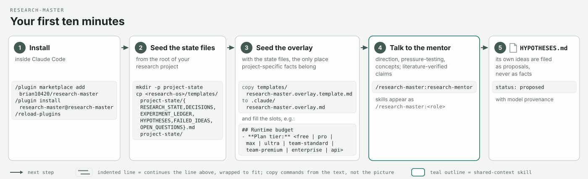
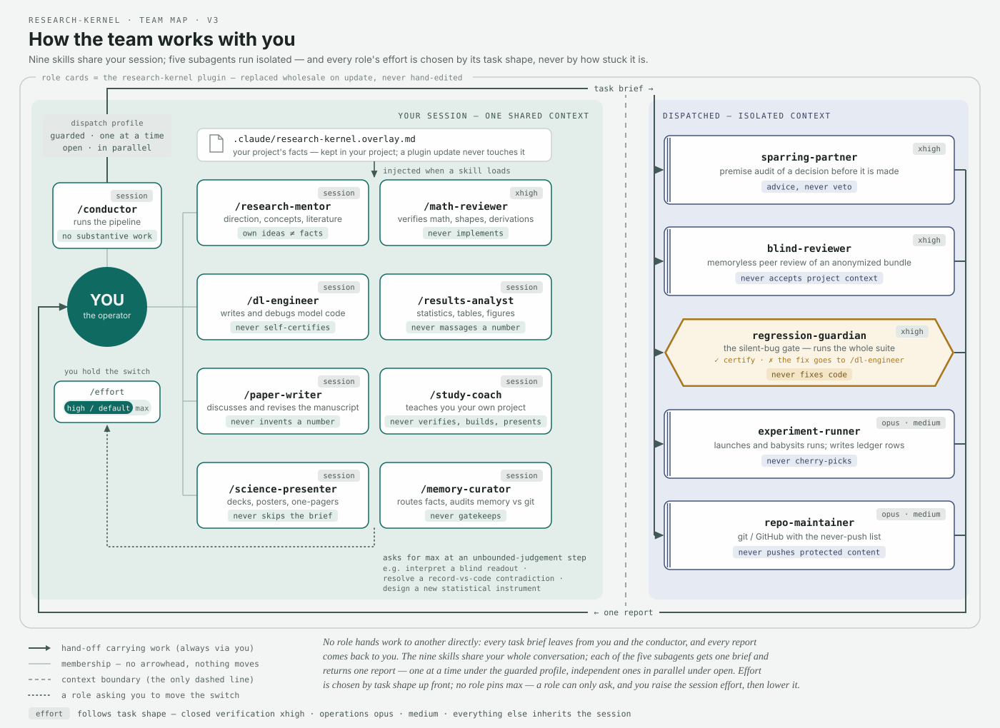
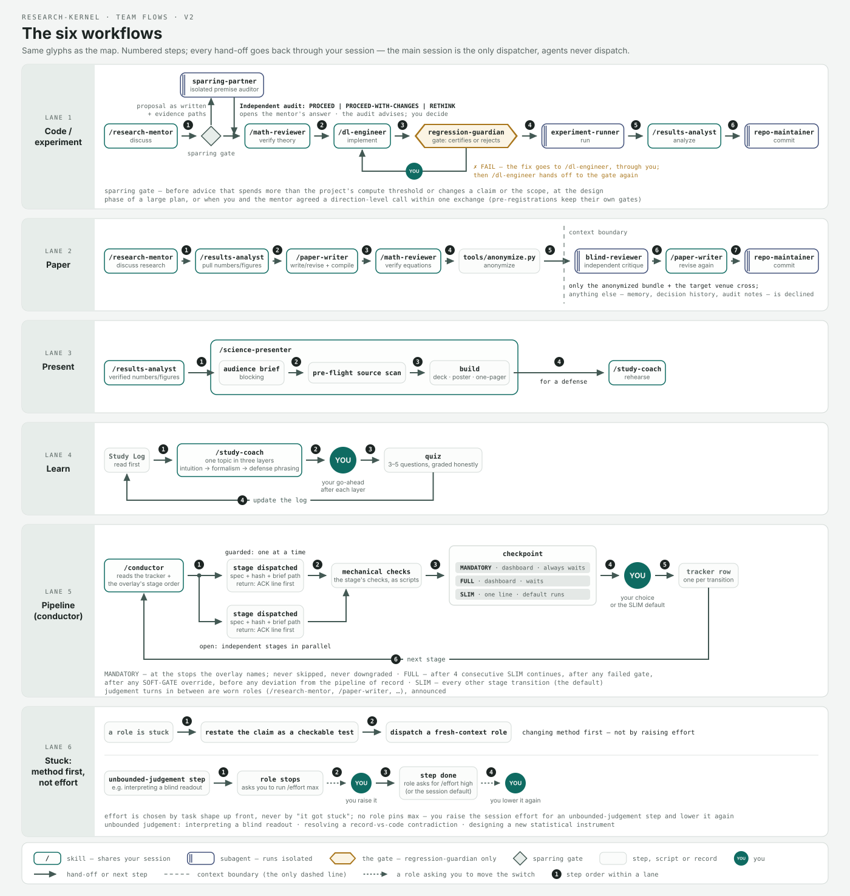
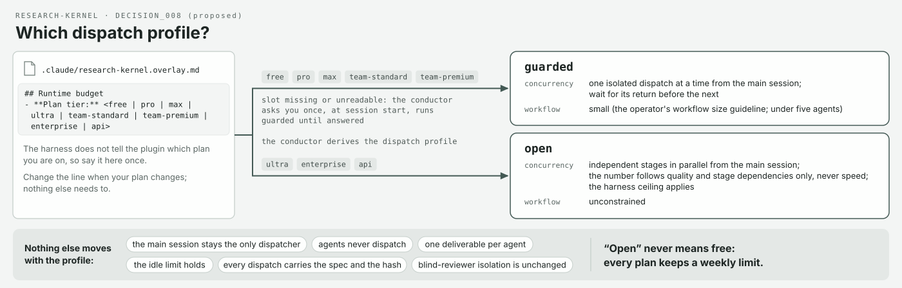

<p align="center">
  
</p>

# research-kernel

**一支開箱即用、給 Claude Code 的 AI 研究團隊——而且它不會讓你只挑自己好看的結果（cherry-pick）。**

十四個角色（一位導師、一位數學審查者、一位工程師、一位同儕盲審者、一道回歸關卡……）、一份每個角色開工前都必須先確認的簡短憲章，以及存放你專案真實狀態的檔案。採用 MIT 授權。
English version: [README.md](README.md)

## 這適合你嗎？

你是研究生，或任何剛踏入研究的人；你手邊有 Claude Code、一個放專案用的 git 儲存庫（repository；空的也沒關係），還有十分鐘。你不需要先知道什麼是「技能」（skill）或「子代理人」（subagent）；每個角色在你呼叫它時都會說明自己是做什麼的。

## 你的前十分鐘



1. **安裝**，在 Claude Code 中執行：
   ```
   /plugin marketplace add brian10420/research-kernel
   /plugin install research-kernel@research-kernel
   /reload-plugins
   ```
2. **建立專案的狀態檔（state files）**——六個 Markdown 檔案，用來記錄結果、決策、假說和未解問題。從 [`templates/project-state/`](templates/project-state/) 複製過來；那裡的 README 寫有確切的指令。
3. **建立覆蓋檔（overlay）**——把 [`templates/research-kernel.overlay.template.md`](templates/research-kernel.overlay.template.md) 複製到你專案裡的 `.claude/research-kernel.overlay.md`，並填好 `## Project` 區塊和 `Plan tier:`（方案等級，plan tier）這一行（見「選擇你的方案等級」）。它和狀態檔一起存放*你的*專案的事實，外掛（plugin）更新也永遠不會覆寫它。
4. **和導師對話：** `/research-kernel:research-mentor`。說說你想弄清楚什麼。它會和你討論方向，並對點子做壓力測試；它提出的東西會以 `status: proposed` 記入你的 `HYPOTHESES.md`，並署上它的名字——絕不會被當成事實。

每個角色回覆的第一行都是 `ACK RULES_HASH=…`。這就是證明它已載入規則的握手（handshake）；如果少了這一行，或其中的雜湊值不是目前的版本，就表示這個角色沒有載入目前的規則。

## 認識團隊



依需求來找，而不是依名字。有九個角色在你的對話**之內**工作：

| 你想要… | 呼叫 | 它絕不會… |
| --- | --- | --- |
| 弄懂你自己的專案；排練口試 | `/research-kernel:study-coach` | 驗證、建置或做簡報 |
| 討論方向；拿文獻檢驗一個點子 | `/research-kernel:research-mentor` | 把自己的點子當成事實宣稱 |
| 檢查推導、張量形狀（shapes）、數值計算（numerics） | `/research-kernel:math-reviewer` | 動手實作 |
| 撰寫或除錯模型、訓練或資料處理的程式碼 | `/research-kernel:dl-engineer` | 認證自己的程式碼 |
| 把執行（run）結果變成統計、表格與圖 | `/research-kernel:results-analyst` | 粉飾數字 |
| 撰寫並修改論文稿 | `/research-kernel:paper-writer` | 捏造數字；把已降級的主張重新誇大 |
| 製作演講、海報或一頁式摘要 | `/research-kernel:science-presenter` | 算出新的統計量；跳過需求簡報（brief） |
| 執行帶有檢查點（checkpoint）的多階段管線（pipeline） | `/research-kernel:conductor` | 自己動手做各階段的工作；跳過 MANDATORY 停止點；推翻 HARD-STOP |
| 保持回憶層（recall layer）整潔 | `/research-kernel:memory-curator` | 當守門人；編輯 `core/`；提交（commit）一項科學主張 |

另外五個角色在對話**之外**執行：它們是帶著全新上下文（context）的子代理人，所以不會繼承你的假設。由你的工作階段派工（dispatch）給它們——你或指揮（conductor）；代理人絕不派工：

| 被派工的角色 | 它做什麼 | 它絕不會… |
| --- | --- | --- |
| `blind-reviewer` | 像陌生人一樣審閱你匿名化後的論文稿 | 接受專案的背景資訊 |
| `sparring-partner` | 在決策做成之前，稽核它的前提 | 否決；看到提案者的推理 |
| `regression-guardian` | 跑完整套測試；認證或駁回一項變更 | 修正程式碼；憑部分執行結果就認證 |
| `experiment-runner` | 啟動並看顧各次執行；寫入帳本（ledger）的列 | 只挑好看的結果；偏離協定 |
| `repo-maintainer` | 處理 git 與 GitHub，並遵守一份「絕不推送」清單（never-push list） | 推送受保護的內容；未經要求就強制推送 |

## 工作流程



建置與測試要通過守護者（guardian）的關卡；論文迴圈只把匿名化後的資料包（bundle）交給盲審者；學習會循環回到你的學習日誌（Study Log）；簡報從已驗證的數字出發；管線泳道只會在具名的檢查點把你叫停；而當你卡關時，團隊會先換**方法**，而不是提高推理強度（effort）。

## 為什麼它不讓你只挑好看的結果

每一次執行在數字產生之前，就先在帳本裡有一列；每個點子都帶著提出者的名字；而只有你能把提案變成事實。背後的七條規則寫在 [`core/SCIENTIFIC_RULES.md`](core/SCIENTIFIC_RULES.md)。

<details>
<summary><b>用白話說七條規則</b></summary>

1. Git、你的筆記和實驗帳本是唯一的科學真實來源；模型的記憶只是提醒，絕不是權威。
2. 每個假說和決策都會註明是誰提出的、何時提出，它目前的狀態，以及證據連結。
3. 模型提出的點子只能以*提案*的身分進來；只有你能接受它們。
4. 盲審者永遠不會知道哪些內容是誰寫的。
5. 每個角色都要證明自己已載入規則——就是那行 `ACK RULES_HASH`。
6. 每一次執行在數字產生之前就先在帳本裡有一列；所有種子（seed）、所有折（fold），連失敗的執行也算在內；什麼都不刪除。
7. 知識在各層之間移動時，一律以審查過的差異（diff）形式進行，絕不直接貼上對話紀錄。

</details>

## 選擇你的方案等級



Claude Code 無法告訴外掛你用的是哪個方案，所以你要在覆蓋檔裡自己說一次：

```
## Runtime budget
- **Plan tier:** pro
```

| 你的方案 | 設定檔 | 指揮會怎麼做 |
| --- | --- | --- |
| free, pro, max, team-standard, team-premium | `guarded` | 一次只讓一個隔離角色在執行中；等它交回報告；工作流程保持精簡 |
| ultra, enterprise, api | `open` | 獨立的階段平行執行，品質與相依關係允許多少就跑多少，絕不為了速度，且不超過執行框架上限 |

少了這一行或值無法辨識 → 在你回答指揮於工作階段開始時的那一次詢問前先用 `guarded`；可選的 `Dispatch profile override:` 一行可指定任一設定檔。**open 絕不代表用量無上限：** 每個方案都保有每週用量上限。不會隨設定檔改變的事：只有你的工作階段（session）能派工、提交或發布；代理人（agent）絕不會再產生代理人；每個代理人只負責一項交付成果；閒置時限照樣適用；每次派工都附上規格與雜湊值；盲審者始終維持盲審。`claude plugin details research-kernel` 會列出 9 個技能與 5 個子代理人，以及它們常駐的 token 成本。

<details>
<summary><b>東西放在哪裡——兩層、兩個家</b></summary>

| 層 | 放在 | 內容 |
| --- | --- | --- |
| **跨專案** | *本儲存庫* | `core/SCIENTIFIC_RULES.md`（憲章）、`core/roles/`（角色規格正本）、跨專案的 `core/DECISIONS.md`、推理強度政策與派工政策、每種狀態檔的結構定義（schema）、編譯層、評估骨架（scaffold） |
| **個別專案** | *每個研究專案自己的儲存庫* | `RESEARCH_STATE.md`、`DECISIONS.md`、`EXPERIMENT_LEDGER.md`、`HYPOTHESES.md`、`FAILED_IDEAS.md`、`OPEN_QUESTIONS.md`，從 [`templates/project-state/`](templates/project-state/) 複製建立，再加上覆蓋檔 |

模型記憶（不論哪家供應商）是回憶層，絕不是權威層。Git、筆記庫（notes vault）和實驗帳本才是唯一的科學真實來源（`core/SCIENTIFIC_RULES.md` §0–§1）。本專案原名 `claude_research_team`，後來在 GitHub 上改名為 `research-kernel`——見 [`MIGRATION_AUDIT.md`](MIGRATION_AUDIT.md)。它建立在不綁定供應商的 **research-os** 架構之上；內部的結構定義仍沿用 `research-os/` 命名空間。

</details>

<details>
<summary><b>本儲存庫的目錄結構</b></summary>

```
core/                     正本、不綁定供應商——請在「這裡」編輯
  SCIENTIFIC_RULES.md     規則；RULES_HASH = sha256(本檔案)[:12]
  DECISIONS.md            DECISION_000 … DECISION_008（架構、記憶、推理強度、角色、§9、派工設定檔）
  RESEARCH_STATE.md  EXPERIMENT_LEDGER.md  HYPOTHESES.md  FAILED_IDEAS.md
  LITERATURE_MAP.md  OPEN_QUESTIONS.md  STUDY_LOG.md      （結構定義，各附一個完整範例）
  roles/                  每個角色一份規格 + README 角色名冊
  disciplines/            跨領域研究用的領域卡格式（目前還沒有卡片）
  effort_policy.yaml      哪些角色帶有強制的 Claude Code effort/model 設定（任務形態原則）
  dispatch_policy.yaml    方案等級 -> 派工設定檔（guarded | open）
CLAUDE.md  AGENTS.md      自動產生的轉接檔（adapter）（tools/sync.py）——切勿手動編輯
.claude/agents/ .claude/skills/   自動產生、自給自足的 Claude Code 包裝檔（wrapper）（規格與規則就放在每個 SKILL.md 旁邊）
skills/  agents/          自動產生、與 .claude/ 逐位元組相同的副本——外掛目錄樹（一般檔案，沒有符號連結）
.claude-plugin/           plugin.json + marketplace.json（本儲存庫本身就是自己的外掛市集（marketplace））
assets/                   標誌、團隊地圖、工作流程、第一天（day-one）與方案等級的圖 + 每張圖各一份主張表（claims table）
adapters/codex/           佔位：AGENTS.md + core/roles 是 Codex 的來源
tools/                    sync.py · check_drift.py · anonymize.py
.githooks/pre-commit      拒絕轉接檔與 core/ 不一致的提交
templates/project-state/  要複製到研究儲存庫的個別專案狀態檔
templates/                學習日誌、簡報日誌（Presentation Log）、工作階段交接、洩漏檢查樣式、專案覆蓋檔
eval/                     預先註冊的評分準則、盲審協定、任務雛形（stub）、密封的標籤對照表
docs/                     設計筆記、強化（hardening）選項、記憶設定、技能建立流程
legacy/                   遷移前、Claude 專用的原始版本（不會被任何東西載入）
```

</details>

<details>
<summary><b>正式的角色說明</b></summary>

[`core/roles/`](core/roles/README.md) 裡有十四個正本（canonical）角色：九個在你的工作階段之內工作的*共享上下文*（shared-context）角色（`math-reviewer`、`dl-engineer`、`research-mentor`、`results-analyst`、`paper-writer`、`study-coach`、`science-presenter`、`memory-curator`、`conductor`），以及五個帶著全新上下文被派工的*隔離*（isolated）角色（`blind-reviewer`、`experiment-runner`、`regression-guardian`、`repo-maintainer`、`sparring-partner`）。每份規格都包含目的、輸入契約、輸出契約、硬性規則（規則 0 一定是金絲雀握手），以及一項 `runtime:` 建議——這項建議絕不鎖定特定供應商或付費等級。[`assets/`](assets/) 裡的圖呈現的是同一個團隊在 Claude Code 執行環境下的樣貌；圖上的每個標籤都能追溯到 [`assets/README.md`](assets/README.md) 裡列出的某一行來源。

**怎麼看團隊地圖。** 兩塊上了底色的區域就是這張圖的核心主張：左邊 = 一個共享上下文（技能看得到你整段對話），右邊 = 各自隔離的上下文（子代理人永遠看不到）。角色之間從不直接交談。派工匯流排（dispatch bus）恰好穿越邊界兩次，分別標為 `task brief`（送出）和 `one report`（傳回）；匯流排上的標籤就是由你的方案等級決定的派工設定檔。六角形就是關卡：`regression-guardian` 是整頁唯一的六角形，也是唯一的琥珀色。每個角色身上的徽章就是它的推理強度，與 `core/effort_policy.yaml` 強制設定的完全一致；沒有任何徽章寫著 `max`——YOU 下方那個開關由你掌控。最外層的框就是外掛：框內的角色卡在更新時會被整批替換；覆蓋檔不屬於外掛——它放在你的專案裡，這就是為什麼你專案的事實要放在那裡。

</details>

<details>
<summary><b>金絲雀握手——為什麼代理人不可能悄悄弄丟規則</b></summary>

子代理人不一定會繼承指令檔。所以：任何產生角色的協調者（orchestrator）都會**把完整的 `core/roles/<role>.md` 內容和 `RULES_HASH=<hash>` 這一行貼進任務提示詞（prompt）裡**；角色輸出的第一行必須是 `ACK RULES_HASH=<hash>`，否則它就停止工作並回報；`regression-guardian` 會駁回任何缺少有效 ACK 的執行紀錄（run log），並把這次駁回記在帳本裡。盲審者的包裝檔另外帶有 `omitClaudeMd: true`，因此使用本外掛的專案自己的指令檔永遠傳不到它那裡。詳見 `core/SCIENTIFIC_RULES.md` §3；可選的機械式強制機制：[`docs/hardening.md`](docs/hardening.md)。

</details>

<details>
<summary><b>編譯層</b></summary>

`CLAUDE.md`、`AGENTS.md`、`.claude/` 裡的包裝檔，以及它們在 `skills/` 與 `agents/` 的副本，全都由 `core/` 產生，並帶有目前的 `RULES_HASH`。絕對不要手動編輯它們。

```bash
python3 tools/sync.py                 # regenerate every adapter (66 files)
python3 tools/check_drift.py          # exit 1 if any adapter disagrees with core/
git config core.hooksPath .githooks   # once per clone: pre-commit refuses stale adapters
claude plugin validate .              # the plugin-directory checks
```

</details>

<details>
<summary><b>推理強度政策（Claude Code）</b></summary>

`core/effort_policy.yaml` 決定哪些包裝檔帶有強制的 `effort:` / `model:` 設定（Claude Code 對技能和子代理人都會遵守這些設定；推理強度無法在派工時傳入，而包裝檔沒有 `effort:` 鍵的角色會沿用工作階段的推理強度）。原則是*由任務形態事先決定*：

| 任務形態 | 設定 | 原因 |
| --- | --- | --- |
| 封閉、單一答案的驗證（`math-reviewer`、`blind-reviewer`、`regression-guardian`、`sparring-partner`） | `xhigh` | 曲線在這裡已經飽和；`max` 只多換來大約一個點，卻要多花約 40 % 的 token |
| 維運操作（`experiment-runner`、`repo-maintainer`） | 強模型（`opus`）、`xhigh` | 推理負擔輕，但一出錯（啟動了錯誤的執行、推送了受保護的路徑）代價很高，且操作者規定 Opus 不低於 high——DECISION_009（原為 `medium`，DECISION_004） |
| 其他所有工作 | 沿用工作階段設定 | 撰寫、分析和對話都在操作者的預設值下進行 |
| 有已簽核計畫的長時程工作 | 工作階段預設值 | 驗證來自計畫、預先註冊和回歸關卡——而不是來自推理強度 |

沒有任何角色鎖定 `max`。遇到需要無邊界判斷的步驟時，角色會請你執行 `/effort max`，並在之後再調低回來。「卡關」是換方法的理由——把主張重新表述成可檢驗的測試、派工給一個全新上下文的角色——而不是調高推理強度的理由。派工設定檔（`core/dispatch_policy.yaml`，DECISION_008）是另一個獨立、依方案等級而定的設定，決定同一時間可以有多少個隔離角色在執行中；它永遠不會改變由誰派工。

</details>

<details>
<summary><b>盲審與評估</b></summary>

`tools/anonymize.py build` 會從審查資料包中移除出處資訊（provenance）、人名、模型名稱、電子郵件和時間戳記，並把標籤對照表密封在 `eval/.sealed/`（已被 git 忽略；審查者永遠不會讀它）。`eval/RUBRIC.md` 是預先註冊（pre-registered）的；`eval/PROTOCOL.md` 定義了兩組比較（純模型 vs 生態系），兩者分開報告，並以盲評方式評分。

</details>

<details>
<summary><b>不透過外掛使用</b></summary>

1. 把 [`templates/project-state/`](templates/project-state/) 複製到專案中（那裡的 README 寫有確切的指令），並寫下第一份 `RESEARCH_STATE.md` 快照。
2. 用於 Claude Code：從這裡複製 `CLAUDE.md` 和 `.claude/`（或用 `tools/sync.py` 就地產生）。包裝檔是自給自足的——每個技能目錄都帶著 `role.md` 和 `RULES.md`——所以從專案根目錄**不需要**能存取到 `core/`。
3. 建立覆蓋檔：把 `templates/research-kernel.overlay.template.md` 複製到 `.claude/research-kernel.overlay.md`，填好每份角色規格最後列出的欄位（路徑、協定（protocol）區塊、不變量（invariants）、防護規則（guards）），以及 `## Runtime budget` 這一行。專案的事實放在那裡和狀態檔中，絕不放進 `core/`。
4. 用於其他任何執行框架（harness）：來源是 `AGENTS.md` + `core/roles/`（`adapters/codex/README.md`）。
5. 可選、只用來記錄環境怪癖的代理人記憶（agent memory）：[`docs/memory-setup.md`](docs/memory-setup.md)。

</details>

<details>
<summary><b>角色是怎麼打造的；搭配技能；誠實聲明</b></summary>

流程文件若沒經過測試，就會說謊。角色檔是針對在基準情況（baseline）下實際觀察到的失敗，以 RED→GREEN 的方式寫成的——[`docs/creating-skills-with-tdd.md`](docs/creating-skills-with-tdd.md)。設計理由（上下文姿態、獨立性、為什麼記憶只能用來回憶）：[`docs/design-notes.md`](docs/design-notes.md)。

搭配使用的第三方技能（未打包進本儲存庫——請從上游安裝）：[mattpocock/skills](https://github.com/mattpocock/skills)（`tdd`、`diagnose`、`grill-me`、`grill-with-docs`、`caveman`、`prototype`、`zoom-out`、`to-prd`、`to-issues`）；[vercel-labs/skills](https://github.com/vercel-labs/skills)（skills 命令列工具（CLI）與 `find-skills`）；[Anthropic superpowers 外掛](https://github.com/anthropics/claude-code)（上述的 TDD 流程就是靠 `writing-skills` 驅動的）。這裡沒有複製它們的任何程式碼；所有署名與授權都仍歸原作者所有。

**誠實聲明。** 角色內容是從一個進行中、尚未發表的機器學習（ML）研究專案的實際運作設定中提煉出來的。所有指標數值、資料集細節、實驗系列（campaign）名稱、檔案清單和個人細節，都是佔位內容或虛構的通用範例；結構與原則則是真實的，並經過實戰考驗。

</details>

## 授權

MIT © [Ting-Yi Lin](https://github.com/brian10420)
